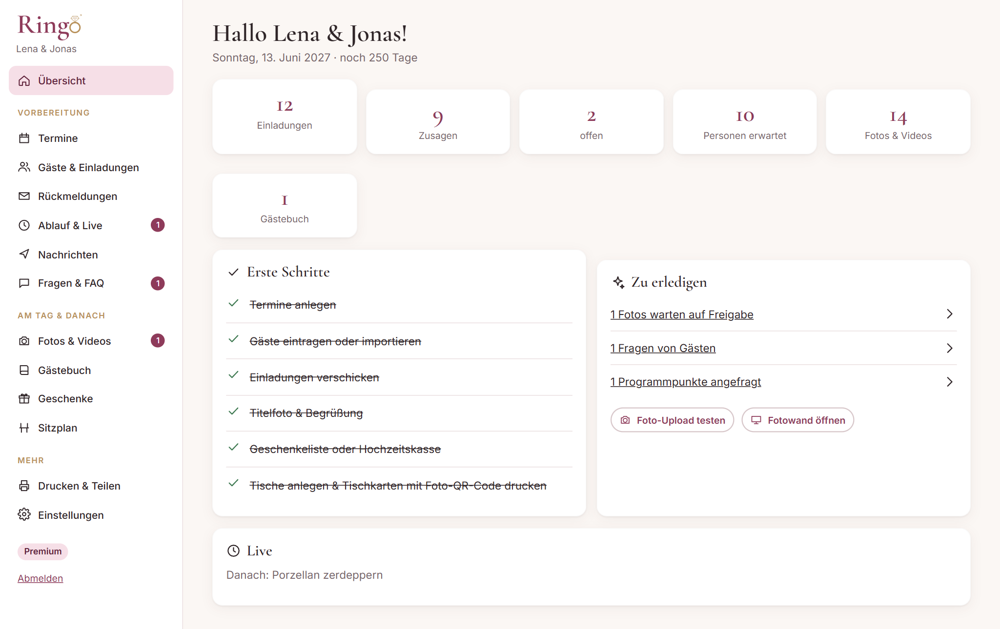
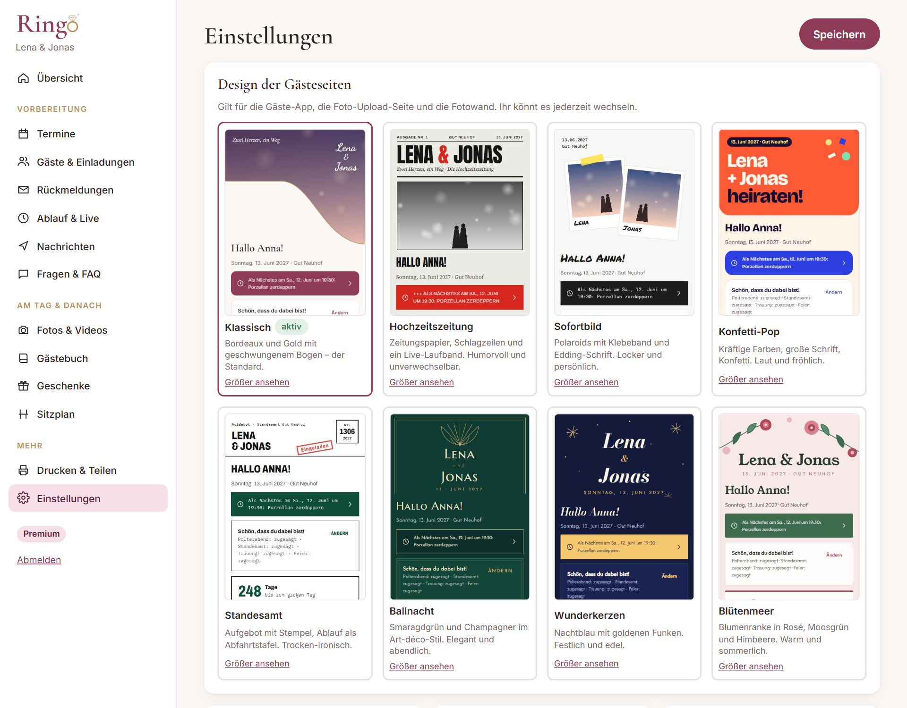
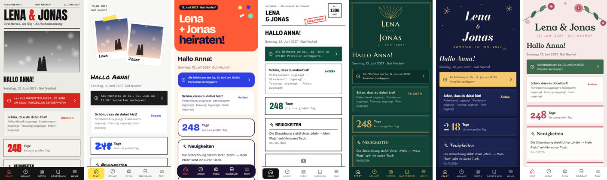
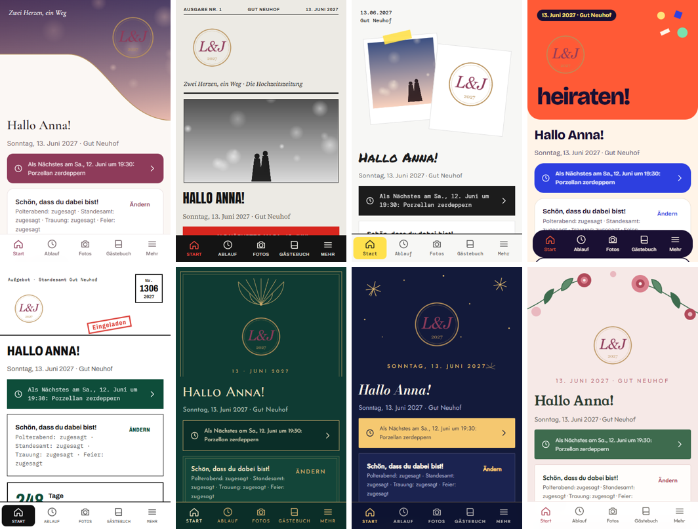
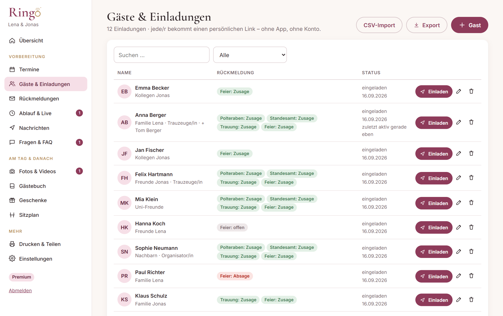
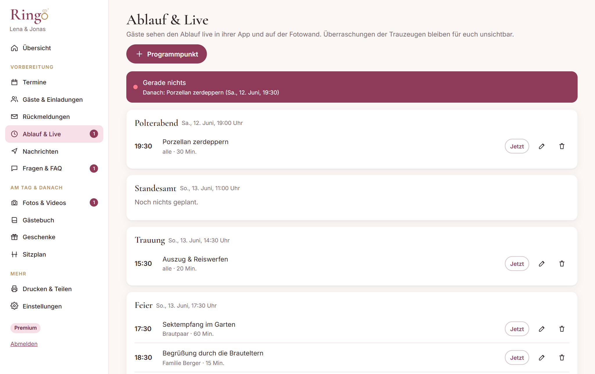
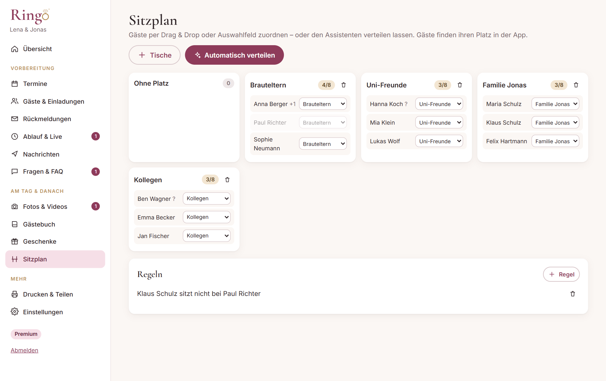
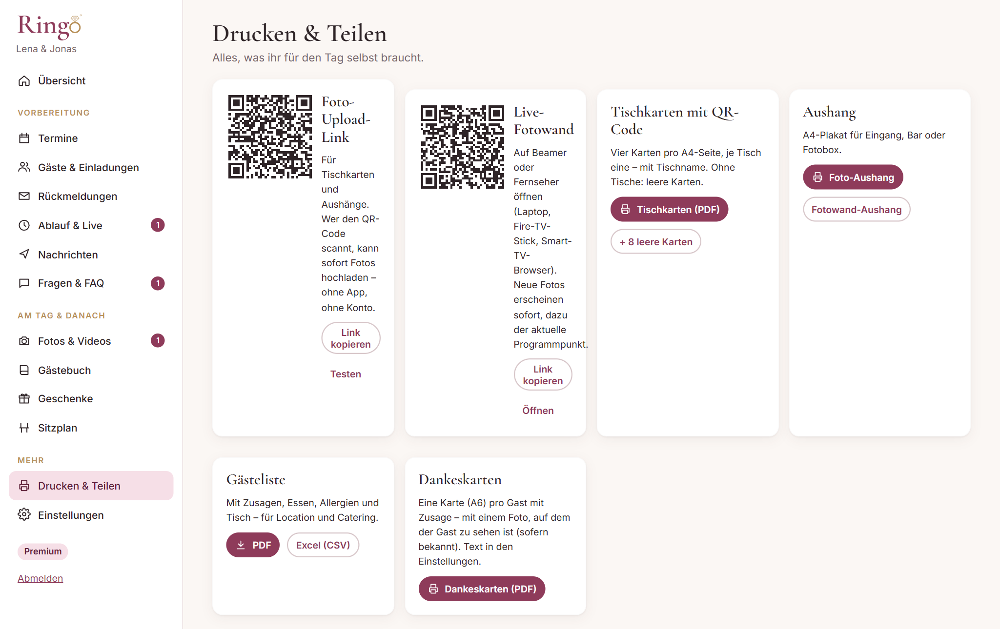
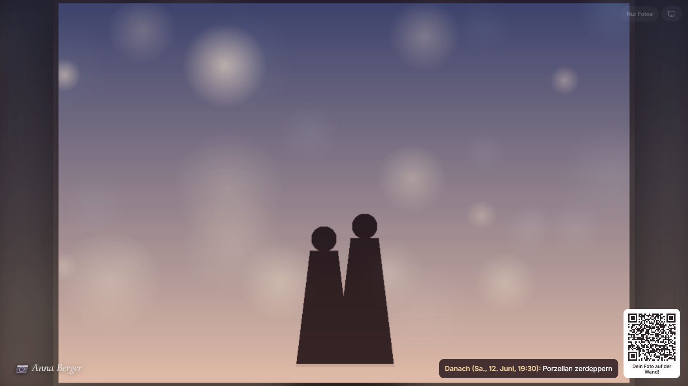

# Handbuch für das Brautpaar

Ringo begleitet eure Hochzeit in drei Phasen: **Vorher** ladet ihr ein und sammelt Zusagen. **Am Tag** landen alle Fotos eurer Gäste im gemeinsamen Album, auf Wunsch live auf der Leinwand. **Danach** behaltet ihr alles: Fotos, Videos, Gästebuch, Fotobuch und Dankeskarten.

Eure Gäste brauchen dafür **keine App und kein Konto**. Jede und jeder bekommt einen persönlichen Link.

---

## 1. Registrieren

1. Öffnet die Startseite und klickt auf **Kostenlos starten**.
2. Tragt eure Vornamen, das Hochzeitsdatum, eine E-Mail-Adresse und ein Passwort (mindestens 8 Zeichen) ein.
3. Ihr landet in der **Verwaltung**. Der Haupttermin „Hochzeitsfeier“ ist bereits angelegt, falls ihr ein Datum angegeben habt.

Die Seite **Übersicht** zeigt eine Liste „Erste Schritte“ und alles, was gerade zu erledigen ist: Fotos zur Freigabe, Fragen von Gästen, angefragte Programmpunkte.



## 2. Einstellungen: Grundlagen eurer Seite

Unter **Einstellungen**:

- **Design der Gästeseiten:** Ganz oben wählt ihr eines von neun Designs. Es gilt für die Gäste-App, die Foto-Upload-Seite und die Fotowand; eure Verwaltung bleibt unverändert. Ein Klick genügt, Gäste mit geöffneter Seite sehen den Wechsel sofort. „Größer ansehen“ zeigt eine Vorschau.

  | Design | Stil |
  |---|---|
  | Klassisch | Bordeaux und Gold mit geschwungenem Bogen (Standard) |
  | Hochzeitszeitung | Zeitungspapier, Schlagzeilen, Live-Laufband |
  | Sofortbild | Polaroids mit Klebeband, Edding-Schrift |
  | Konfetti-Pop | Kräftige Farben, große Schrift, Konfetti |
  | Standesamt | Aufgebot mit Stempel, Ablauf als Abfahrtstafel |
  | Ballnacht | Smaragdgrün und Champagner im Art-déco-Stil |
  | Wunderkerzen | Nachtblau mit goldenen Funken |
  | Blütenmeer | Blumenranke in Rosé, Moosgrün und Himbeere |





- **Eure Hochzeit:** Namen, Datum, Motto, eine Begrüßung (steht ganz oben bei den Gästen) und optional eure Geschichte.
- **Titelfoto:** Es erscheint im geschwungenen Bogen oben auf jeder Seite.
- **Logo:** Statt eurer Namen als Schriftzug könnt ihr ein eigenes, quadratisches Logo hochladen.
  - Es erscheint in jedem Design im Kopfbereich der Gäste-App und der Foto-Upload-Seite, auf der Fotowand sowie auf Tischkarten, Aushang und dem Titel des Fotobuchs.
  - Ideal ist ein PNG mit transparentem Hintergrund, mindestens 500 × 500 Pixel. Nicht quadratische Bilder werden nicht beschnitten, sondern mit transparentem Rand ergänzt.
  - Bei dunklen Designs (Klassisch, Ballnacht, Wunderkerzen) wirkt ein helles Logo am besten.
  - Mit **Entfernen** zeigen die Seiten wieder eure Namen.

  
- **Für die Gäste:**
  - Dresscode und Rückmeldefrist.
  - Essensoptionen, mit Komma getrennt. Lasst das Feld leer, wenn ihr nicht nach dem Essen fragen wollt.
- **Fotos:**
  - *Erst nach Freigabe zeigen:* Neue Gästefotos seht zuerst nur ihr.
  - *Unplugged Ceremony:* Gäste werden gebeten, während der Trauung keine Fotos zu machen.
  - *Finde meine Fotos* (Premium): Gäste finden per Selfie die Fotos, auf denen sie zu sehen sind. Die Erkennung läuft auf dem Handy des Gastes. Bitte erwähnt die Funktion in eurer Einladung.
- **Geschenke & Bezahlung:**
  - Kontoinhaber und IBAN: Daraus entsteht ein **GiroCode**, den Gäste mit ihrer Banking-App scannen.
  - Optional ein PayPal.me-Link und ein Text zu Geschenken.
- **Dankeskarten:** Der Text für die Karten nach der Hochzeit. Platzhalter: `{vorname}`, `{name}`.

Klickt anschließend auf **Speichern**.

## 3. Termine

Unter **Termine** legt ihr alles an, wozu ihr einladet: Standesamt, Trauung, Feier, Polterabend, Katerfrühstück.

- **Haupttermin:** Genau ein Termin ist der Haupttermin. Er zählt für den Countdown, den Sitzplan und die Personenzahl.
- **Wer sieht was:** Jeder Gast sieht nur die Termine, zu denen er eingeladen ist. Beispiel: Zum Standesamt kommt nur die Familie.
- **Neue Termine:** Bei einem neuen Termin könnt ihr wählen, ob alle bisherigen Gäste dazu eingeladen werden.
- **Hinweise:** Kurze Hinweise für die Gäste, z. B. „Parken im Parkhaus Kornmarkt“.

## 4. Gäste eintragen

Unter **Gäste & Einladungen**:

- **Einzeln:** Klickt auf **+ Gast**. Pflicht ist nur der Vorname.
  - Die Handynummer braucht ihr für den Versand per WhatsApp.
  - Die **Gruppe** (z. B. „Familie Braut“, „Uni-Freunde“) hilft später beim Sitzplan.
  - Die **Rolle** legt fest, wer den geheimen Team-Bereich bekommt: *Trauzeuge/in* oder *Organisator/in*.
  - Mit „darf eine Begleitung mitbringen“ kann der Gast den Namen der Begleitung angeben.
- **Per Liste:** Klickt auf **CSV-Import**. Exportiert eure Liste aus Excel, Numbers oder Google Sheets als CSV. Die erste Zeile enthält die Spaltennamen, zum Beispiel:

  ```
  Vorname;Nachname;E-Mail;Telefon;Gruppe;Seite;Begleitung
  Anna;Berger;anna@example.com;0151 1234567;Familie Braut;Braut;ja
  ```

  Erkannt werden Vorname (Pflicht), Nachname, E-Mail, Telefon/Handy, Gruppe, Seite (Braut/Bräutigam) und Begleitung (ja/nein). Excel-Dateien mit Umlauten werden automatisch richtig gelesen.

- **Export:** Die komplette Liste mit allen Rückmeldungen gibt es als Excel-CSV.



## 5. Einladen

Klickt bei einem Gast auf **Einladen**. Ihr seht den fertigen Einladungstext mit allen Terminen und dem **persönlichen Link** und könnt ihn vor dem Senden anpassen. Für den Versand gibt es mehrere Wege:

- **WhatsApp:** Öffnet WhatsApp mit dem fertigen Text an die hinterlegte Nummer.
- **E-Mail-Programm:** Öffnet euer Mailprogramm mit dem Text.
- **Direkt senden:** Verfügbar, wenn der Betreiber den Mailversand eingerichtet hat. Dann gibt es oben auch „Alle per E-Mail einladen“ für alle noch nicht Eingeladenen.
- **Text kopieren / Nur Link:** Für SMS, Signal oder eine Papiereinladung. Den Link könnt ihr auch als QR-Code drucken.

Die Liste merkt sich, wer schon eingeladen ist, und zeigt, wann ein Gast zuletzt aktiv war.

> **Link weitergeleitet?** Unter *Einladen → Link vergessen/weitergeleitet?* erzeugt ihr einen neuen Link. Der alte funktioniert dann nicht mehr.

## 6. Rückmeldungen

Unter **Rückmeldungen** seht ihr pro Termin die Zahl der Personen (inklusive Begleitungen und Kindern), die Zu- und Absagen und wie viele schon geantwortet haben. Darunter stehen:

- die Essenswünsche als Summen, für das Catering,
- Allergien und Unverträglichkeiten,
- wer eine Übernachtung braucht,
- **Musikwünsche** für DJ oder Band,
- persönliche Nachrichten eurer Gäste an euch.

Die **Gästeliste als PDF** enthält Zusagen, Essen, Allergien und Tisch. So könnt ihr sie direkt an Location und Catering weitergeben.

## 7. Ablauf & Live

Unter **Ablauf & Live** plant ihr pro Termin den Zeitplan: Was, wann, wie lange, wer, und welche Technik gebraucht wird.

- **Beiträge von Gästen:**
  - Gäste melden selbst Programmpunkte an, etwa eine Rede, ein Spiel oder ein Lied. Diese erscheinen als **Anfrage**, und ihr nehmt sie an oder lehnt sie ab.
  - Trauzeugen und Organisatoren können Anfragen ebenfalls bestätigen.
- **Überraschungen:** Programmpunkte, die als Überraschung markiert sind, seht ihr nicht. Sie tauchen erst im Moment ihres Beginns live auf.
- **Live:**
  - Gäste sehen in ihrer App und auf der Fotowand automatisch, was gerade läuft und was als Nächstes kommt.
  - Wenn der Zeitplan sich verschiebt, tippt ihr (oder eure Trauzeugen in ihrem Team-Bereich) bei einem Punkt auf **Jetzt**.
  - **Automatik** schaltet zurück auf den Zeitplan.



## 8. Nachrichten an alle

Unter **Nachrichten** schreibt ihr kurze Neuigkeiten, zum Beispiel „Der Shuttlebus fährt um 17:15 an der Kirche ab.“

- Die Nachricht erscheint **sofort** in der App aller Gäste.
- Optional geht sie zusätzlich per E-Mail raus.
- **Für WhatsApp kopieren:** Damit postet ihr denselben Text in eure WhatsApp-Gruppe. Ringo ersetzt eure Gruppe nicht, sondern ergänzt sie.

## 9. Fragen & FAQ

Gäste können in ihrer App Fragen stellen, etwa „Wo kann ich parken?“.

- **FAQ zuerst:** Gibt es eine passende **FAQ**, bekommt der Gast sofort die Antwort.
- **KI-Assistent (Premium):** Ist er eingerichtet, beantwortet er Fragen aus allen Infos, die ihr eingetragen habt. Er erfindet nichts dazu.
- **Alles andere landet bei euch:** Antwortet direkt. Mit einem Haken wird die Antwort gleichzeitig zur FAQ für alle.

Tipp: Beantwortet die Klassiker vorab, also Parken, Kinder, Dresscode, Übernachtung, Geschenke und Anfahrt. Das spart euch Dutzende Nachrichten.

## 10. Geschenke

Unter **Geschenke** gibt es zwei Arten von Wünschen:

- **Hochzeitskasse / Erlebnis:** Gäste geben einen beliebigen Betrag, ihr seht den Fortschritt zum Zielbetrag. Beliebt ist eine Hochzeitsreise in Etappen: „Abendessen am Strand – 120 €“, „Surfkurs – 180 €“.
- **Konkretes Geschenk:** Wird reserviert, auch in mehreren Stück (z. B. 4 × Weingläser). Was vergeben ist, kann niemand doppelt schenken.

Nach der Zusage bekommt der Gast einen **GiroCode** zum Scannen oder einen PayPal-Link. Das Geld geht **direkt an euch**, Ringo wickelt keine Zahlungen ab. Mit „erhalten“ hakt ihr ab, was angekommen ist. Gäste können auch anonym schenken.

## 11. Sitzplan (Premium)

Unter **Sitzplan**:

1. **+ Tische** legt Tische mit Platzzahl an. Klickt auf einen Tischnamen, um ihn umzubenennen.
2. **Regeln** wie „Onkel Klaus sitzt nicht bei Tante Maria“ oder „Kinder sitzen bei ihren Eltern“.
3. **Automatisch verteilen** setzt alle Gäste mit Zusage oder offener Antwort. Der Assistent achtet dabei auf:
   - Begleitungen und Kinder (sie belegen Plätze),
   - Gruppen (sie sitzen bevorzugt zusammen),
   - eure Regeln.
   Bestehende Zuordnungen könnt ihr behalten.
4. **Feinschliff:** Zieht Gäste per Drag & Drop an einen anderen Tisch oder wählt den Tisch im Auswahlfeld.

Gäste sehen ihren Tisch und ihre Tischnachbarn in der App unter **Mein Platz**. Das klappt, sobald mindestens ein Gast einen Tisch hat.



## 12. Drucken & Teilen

Unter **Drucken & Teilen** findet ihr alles für den Tag selbst:

| Was | Wofür |
|---|---|
| **Tischkarten (PDF)** | 4 Karten pro A4-Seite, je Tisch eine, mit Tischname und QR-Code zum Foto-Upload. „+ 8 leere Karten“ für Bar, Fotobox oder Sektempfang |
| **Foto-Aushang** | A4-Plakat mit großem QR-Code für Eingang oder Fotobox |
| **Fotowand-Aushang** | A4-Plakat mit dem Link zur Fotowand, für die Technik |
| **Gästeliste (PDF/Excel)** | für Location und Catering |
| **Dankeskarten (PDF)** | eine A6-Karte pro Gast mit Zusage, mit einem Foto, auf dem der Gast zu sehen ist (sofern bekannt), sonst einem eurer Favoriten |



### Live-Fotowand (Premium)

Die Fotowand zeigt alle freigegebenen Fotos und Videos als Diashow auf Beamer oder Fernseher. Neue Fotos erscheinen sofort mit dem Hinweis „Neu!“. Videos laufen ohne Ton.

Es gibt zwei Ansichten. Ihr wechselt mit der Taste **F** oder dem Knopf **Nur Fotos**. Die Knöpfe sind halbtransparent und werden erst beim Darüberfahren mit der Maus deutlich sichtbar. Der Browser merkt sich die gewählte Ansicht.

- **Mit Seitenleiste:** Rechts stehen eure Namen, das Motto, was gerade läuft und was als Nächstes kommt, die Zahl der Fotos und ein großer QR-Code zum Mitmachen. Gut für den Anfang der Feier, wenn die Gäste den QR-Code noch kennenlernen.
- **Nur Fotos:** Die Bilder nutzen den ganzen Bildschirm. Unten rechts bleiben ein kleiner QR-Code und eine Zeile zum aktuellen bzw. nächsten Programmpunkt. Gut für die Party, wenn die Fotos im Mittelpunkt stehen.

Fotos werden in beiden Ansichten nie beschnitten. Hochformat und Querformat füllen die Fläche so weit wie möglich, die Ränder füllt eine unscharfe Version des Fotos.




## 13. Am Tag selbst – Checkliste

- [ ] Tischkarten und Aushang ausgedruckt und verteilt.
- [ ] Foto-Upload einmal selbst getestet (QR-Code scannen, Foto hochladen).
- [ ] **Fotowand** (Premium): Den Link aus *Drucken & Teilen* auf einem Laptop am Beamer oder in einem Smart-TV-Browser öffnen und mit dem Knopf unten rechts auf Vollbild schalten. Mit **F** wechselt ihr zwischen der Ansicht mit Seitenleiste und „Nur Fotos“. Der Bildschirm bleibt während der Feier wach, sofern der Browser das unterstützt.
- [ ] WLAN oder Mobilfunk an der Location geprüft. Fotos laden auch über mobiles Internet, werden aber vorher auf dem Handy verkleinert.
- [ ] Eine Person (z. B. Trauzeuge/in) mit der Live-Steuerung betraut, falls sich der Ablauf verschiebt.
- [ ] Bei „Fotos erst nach Freigabe zeigen“: Jemand gibt zwischendurch Fotos frei. Für die Party lieber ausschalten.

## 14. Nach der Hochzeit

- **Fotos & Videos:** Unter *Fotos & Videos* lädt **Alles herunterladen (ZIP)** alle Fotos, Videos und Gästebuch-Aufnahmen in voller Qualität. Mit ★ markiert ihr Favoriten.
- **Fotobuch (Premium):** Erzeugt ein druckfertiges A4-PDF. Ausgewählt werden eure Favoriten und dann die schärfsten Fotos, fast gleiche Bilder werden übersprungen. Das PDF lässt sich bei jedem Fotobuch-Dienst oder Copyshop drucken.
- **Gästebuch:** Alle Texte, Sprach- und Videobotschaften.
- **Dankeskarten:** siehe oben.
- **Löschen:** Unter *Einstellungen → Hochzeit endgültig löschen* entfernt ihr alles unwiderruflich. Ladet vorher das ZIP herunter.

## 15. Trauzeugen & Organisatoren

Gäste mit der Rolle *Trauzeuge/in* oder *Organisator/in* sehen in ihrer App einen **Team-Bereich**, den ihr selbst nicht seht. Er enthält:

- alle Programmpunkte inklusive Überraschungen und offener Anfragen, mit Freigabe,
- die **Live-Steuerung** für den Tag,
- **Geschichten**, die Gäste für die Reden eingereicht haben,
- einen **Rede-Helfer**. Er baut daraus eine Gliederung, mit KI-Assistent einen ersten Entwurf.
- **Absprachen** im Team mit Telefonnummern.

## 16. Datenschutz – was ihr wissen solltet

- **Wer sieht was:** Fotos sehen nur Gäste mit Einladungslink sowie Personen, die den QR-Code am Tisch scannen. Der Upload-Link erlaubt nur das Hochladen, nicht das Ansehen fremder Fotos. Die Fotowand braucht einen eigenen, geheimen Link.
- **Eure Verantwortung:** Ihr tragt die Daten eurer Gäste ein. Dafür seid ihr mitverantwortlich. Tragt nur ein, was ihr wirklich braucht.
- **Gesichtserkennung:** Weist Gäste in der Einladung auf „Finde meine Fotos“ hin, wenn ihr die Funktion nutzt. Sie ist für Gäste freiwillig. Gespeicherte Merkmale kann jeder Gast selbst löschen.
- **Eigene Fotos:** Gäste können ihre eigenen Fotos jederzeit selbst löschen.
